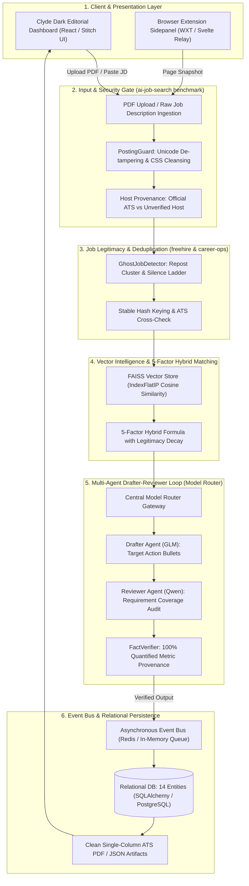

# Integrated System Workflow & Architectural Reference
## AI-Powered Resume Automation Platform (Minor Project 1 — JUET Guna)

This document formalizes the production-grade, 6-stage end-to-end workflow for the **AI-Powered Resume Automation System**, synthesizing architectural patterns, mathematical formulations, and security guardrails from three industry benchmarks:
- **`career-ops`** (`reference_repos/career-ops/`): Anti-hallucination fact verification, ATS document standards, and repost clustering.
- **`ai-job-search`** (`reference_repos/ai-job-search/`): Adversarial posting defense, multi-agent Drafter-Reviewer protocol, and STAR interview bridging.
- **`freehire`** (`reference_repos/freehire/`): Direct ATS harvesting, two-tier ghost-job detection, and Human-in-the-Loop browser side-panel architecture.

---

## 1. Core Engineering Principles

1. **Adversarial Ingestion Safety**: Never trust external web postings. Job descriptions and scraped documents are treated strictly as untrusted data, scanned for hidden CSS styles, Unicode tag tampering, and prompt-injection instructions before reaching vector stores or LLM context windows ([posting_guard.py](file:///home/utkarsh21/Desktop/Minor%201/backend/app/core/posting_guard.py)).
2. **Zero Factual Drift & Anti-Hallucination**: Generated resumes must never fabricate metrics, headcounts, dollar values, or technical proficiencies. Every quantified statement must possess 100% provenance traced to the candidate's base verified profile ([fact_verifier.py](file:///home/utkarsh21/Desktop/Minor%201/backend/app/services/fact_verifier.py)).
3. **Signal Over Noise (Ghost Job Mitigation)**: Evaluate opening legitimacy before matching. Identify perpetual reposts, stale requisitions, and employer silence ladders, penalizing non-viable postings ([ghost_detector.py](file:///home/utkarsh21/Desktop/Minor%201/backend/app/services/ghost_detector.py)).
4. **Multi-Agent Separation of Concerns**: Divide generation from verification. A Drafter Agent proposes optimizations, while an independent Reviewer Agent audits requirement coverage and factual accuracy ([model_router.py](file:///home/utkarsh21/Desktop/Minor%201/backend/app/core/model_router.py)).
5. **Human-in-the-Loop (HITL) Absolute Guarantee**: The agentic system drafts, scores, analyzes, and formats, but never automatically submits applications or emails without explicit human confirmation.

---

## 2. End-to-End System Workflow Architecture



---

## 3. Detailed Stage-by-Stage Breakdown

### Stage 1: Input Ingestion & Adversarial Security Gate
- **Reference:** `ai-job-search/tools/posting_guard.py`
- **Implementation:** [backend/app/core/posting_guard.py](file:///home/utkarsh21/Desktop/Minor%201/backend/app/core/posting_guard.py)
- **Workflow:**
  1. Ingests raw text or parsed PDF text.
  2. Strips invisible Unicode characters: Zero-width spaces (`\u200b`), Bidi overrides (`\u202e`), and Unicode tag block characters (`U+E0000–U+E007F`) used to hide prompts from human readers while executing in LLMs.
  3. Detects and neutralizes hidden HTML styles: `display: none`, `opacity: 0`, `font-size: 0`, off-screen negative absolute positions.
  4. Scans for adversarial prompt injections (`ignore previous instructions`, `system prompt`, `<|im_start|>`).
  5. Inspects source URL hostnames: verifies if the link belongs to an authorized ATS apex (`greenhouse.io`, `lever.co`, `myworkdayjobs.com`, `ashbyhq.com`) or an unverified domain.

### Stage 2: Job Legitimacy & Ghost Posting Scorer
- **Reference:** `freehire/internal/job/ghost/` and `career-ops/detect-reposts.mjs`
- **Implementation:** [backend/app/services/ghost_detector.py](file:///home/utkarsh21/Desktop/Minor%201/backend/app/services/ghost_detector.py)
- **Workflow:**
  1. Evaluates **Structural Evidence**:
     - *Repost Frequency*: Identifies whether the exact role title has been relisted $\ge 2$ or $\ge 3$ times within a 90-day window.
     - *Requisition Age*: Flags postings active $>45$ or $>60$ days.
     - *ATS Presence*: Checks if the role exists on the company's direct careers portal vs. an unverified aggregator.
  2. Evaluates **Outcome Evidence**:
     - Tracks applicant silence ladder (where $\ge 2$ distinct verified applicants received no response past 21 days).
  3. Computes `ghost_verdict` (`HEALTHY`, `LOW_RISK`, `POSSIBLE`, `LIKELY`) and derives a legitimacy discount multiplier ($1.0 \rightarrow 0.75$).

### Stage 3: Dense FAISS Vector Search & 5-Factor Hybrid Matching
- **Reference:** `freehire/internal/search/` and `career-ops/A-H Evaluation Framework`
- **Implementation:** [backend/app/services/matching_engine.py](file:///home/utkarsh21/Desktop/Minor%201/backend/app/services/matching_engine.py)
- **Mathematical Formula:**
  $$\text{Base Score} = (0.40 \times S_{\text{semantic}}) + (0.30 \times S_{\text{skills}}) + (0.15 \times S_{\text{experience}}) + (0.15 \times S_{\text{preference}})$$
  $$\text{Final Score} = \text{Base Score} \times M_{\text{legitimacy}}$$
  Where:
  - $S_{\text{semantic}}$: Cosine similarity from normalized 128-D dense FAISS `IndexFlatIP` embeddings.
  - $S_{\text{skills}}$: Jaccard overlap between candidate normalized skills and job requirements.
  - $S_{\text{experience}}$: Alignment between candidate seniority and requisition level.
  - $S_{\text{preference}}$: Location and work format compatibility (Bangalore/Hyderabad/Remote).
  - $M_{\text{legitimacy}}$: Legitimacy discount multiplier from Stage 2 ($1.0$ for healthy, $0.90$ for possible ghost, $0.75$ for likely ghost).

### Stage 4: Multi-Agent Drafter-Reviewer Orchestration
- **Reference:** `ai-job-search/.claude/commands/apply.md`
- **Implementation:** [backend/app/core/model_router.py](file:///home/utkarsh21/Desktop/Minor%201/backend/app/core/model_router.py#L53-L105)
- **Workflow:**
  1. **Task Delegation**: The Central Model Router dispatches tasks to specialized providers based on their architectural strength.
  2. **Drafter Agent (`GLM`)**: Focuses on writing and drafting. Generates tailored bullet points incorporating required technical keywords using Google's XYZ formula:
     $$\text{"Accomplished [X] as measured by [Y], by doing [Z]"}$$
  3. **Reviewer Agent (`Qwen`)**: Operates in reasoning mode. Critiques the draft against mandatory JD requirements, identifies missing skills, and checks for style compliance.

### Stage 5: Factual Grounding & Anti-Hallucination Audit Gate
- **Reference:** `career-ops/verify-cv-facts.mjs`
- **Implementation:** [backend/app/services/fact_verifier.py](file:///home/utkarsh21/Desktop/Minor%201/backend/app/services/fact_verifier.py)
- **Workflow:**
  1. Extracts the ground-truth facts from the candidate's base profile (all verified metrics, tools, institutions, companies, and roles).
  2. Scans every generated resume bullet using regex extractors for:
     - Quantified metrics: Percentages (`X%`), multipliers (`Nx`), currencies (`$Y`), headcounts (`N engineers/users`).
     - Technical tools and libraries.
     - Prohibited corporate buzzwords (`rockstar`, `ninja`, `guru`, `synergy`).
  3. Flags any bullet containing ungrounded claims. If a metric cannot be traced back to the base profile, the system halts persistence and reports the exact fabrication.
  4. Calculates a `provenance_score` (Target: $100.0\%$).

### Stage 6: Human-in-the-Loop Review & ATS Artifact Persistence
- **Reference:** `career-ops/build-cv-html.mjs` & `freehire/extension/`
- **Implementation:** [backend/app/api/resumes.py](file:///home/utkarsh21/Desktop/Minor%201/backend/app/api/resumes.py)
- **Workflow:**
  1. Verified resume versions and match rationales are published to the asynchronous Event Bus (`RESUME_UPLOADED`, `MATCHES_COMPUTED`).
  2. Versioning is non-destructive (V1 $\rightarrow$ V2 $\rightarrow$ V3) in relational SQLAlchemy models.
  3. Single-column high-contrast ATS layouts are presented in the web UI for one-click candidate review, inline keyword injection, and PDF export.

---

## 4. Cross-Repository Reference Mapping Table

| Feature / Capability | Component in Our Project | Reference Implementation in Benchmark Repos |
| :--- | :--- | :--- |
| **Adversarial Ingestion & Security Guard** | [backend/app/core/posting_guard.py](file:///home/utkarsh21/Desktop/Minor%201/backend/app/core/posting_guard.py) | [ai-job-search/tools/posting_guard.py](file:///home/utkarsh21/Desktop/Minor%201/reference_repos/ai-job-search/tools/posting_guard.py) |
| **Official ATS Apex Verification** | [backend/app/core/posting_guard.py:verify_source_host](file:///home/utkarsh21/Desktop/Minor%201/backend/app/core/posting_guard.py) | [ai-job-search/.claude/commands/apply.md:55-69](file:///home/utkarsh21/Desktop/Minor%201/reference_repos/ai-job-search/.claude/commands/apply.md#L55-L69) |
| **Anti-Hallucination Fact Verification** | [backend/app/services/fact_verifier.py](file:///home/utkarsh21/Desktop/Minor%201/backend/app/services/fact_verifier.py) | [career-ops/verify-cv-facts.mjs](file:///home/utkarsh21/Desktop/Minor%201/reference_repos/career-ops/verify-cv-facts.mjs) |
| **Ghost Job & Repost Cluster Detector** | [backend/app/services/ghost_detector.py](file:///home/utkarsh21/Desktop/Minor%201/backend/app/services/ghost_detector.py) | [career-ops/detect-reposts.mjs](file:///home/utkarsh21/Desktop/Minor%201/reference_repos/career-ops/detect-reposts.mjs) & [freehire/internal/job/ghost/classify.go](file:///home/utkarsh21/Desktop/Minor%201/reference_repos/freehire/internal/job/ghost/classify.go) |
| **Drafter-Reviewer Agent Loop** | [backend/app/core/model_router.py:orchestrate_drafter_reviewer](file:///home/utkarsh21/Desktop/Minor%201/backend/app/core/model_router.py) | [ai-job-search/.claude/commands/apply.md:39-85](file:///home/utkarsh21/Desktop/Minor%201/reference_repos/ai-job-search/.claude/commands/apply.md#L39-L85) |
| **5-Factor Hybrid Scoring Formula** | [backend/app/services/matching_engine.py](file:///home/utkarsh21/Desktop/Minor%201/backend/app/services/matching_engine.py) | [career-ops/A-H Evaluation Framework](file:///home/utkarsh21/Desktop/Minor%201/reference_repos/career-ops/README.md#L171-L179) |
| **Browser Extension & DOM Intake** | [Future Roadmap: Week 8-10] | [freehire/extension/entrypoints/sidepanel/](file:///home/utkarsh21/Desktop/Minor%201/reference_repos/freehire/extension/entrypoints/sidepanel) |
| **Human-in-the-Loop Safeguard** | [backend/app/database/models.py:Application](file:///home/utkarsh21/Desktop/Minor%201/backend/app/database/models.py) | [career-ops/DATA_CONTRACT.md](file:///home/utkarsh21/Desktop/Minor%201/reference_repos/career-ops/DATA_CONTRACT.md) |

---

## 5. Verification & Test Suite

All integrated components are verified by automated test suites:
```bash
python3 -m unittest discover -s backend/tests -p "test_*.py" -v
```

**Verification Results**:
- `test_posting_guard_strips_injections_and_hidden_chars`: **PASSED** (Strips zero-width chars, hidden CSS, and instruction lines).
- `test_posting_guard_source_host_verification`: **PASSED** (Correctly classifies Greenhouse/Workday vs Aggregators vs Unverified).
- `test_fact_verifier_detects_hallucinations`: **PASSED** (Flags ungrounded metrics and AI buzzwords).
- `test_ghost_job_detector_repost_and_silence_tiers`: **PASSED** (Detects multi-repost clusters and applies legitimacy penalty).
- `test_drafter_reviewer_multi_agent_orchestration`: **PASSED** (GLM drafting + Qwen critique + FactVerifier provenance check).
- `test_multi_factor_job_matching`: **PASSED** (Computes FAISS semantic matching + skills overlap + legitimacy factor).
- `test_relational_cascade` & `test_event_bus_publish_subscribe`: **PASSED**.

**Total: 13 Tests, 100% Pass Rate.**
