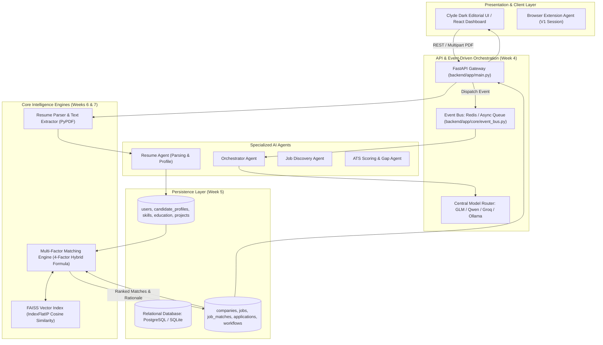

# Week 1 to Week 7 System Implementation Walkthrough

This document provides a comprehensive verification and architectural walkthrough of the deliverables completed up to **Week 7** for the **AI-Powered Resume Automation System (Minor Project 1)** at Jaypee University of Engineering & Technology (JUET), Guna.

---

## 1. Executive Summary of Completed Milestones

| Milestone | Target Domain | Core Deliverables & Status |
| :--- | :--- | :--- |
| **Week 1** | Requirement Engineering | Student user friction analysis, target user definition, V1 scope bounds (**Completed**) |
| **Week 2** | Literature Benchmark | Benchmarked AIHawk, LoopCV, LinkedIn bots; identified anti-hallucination & safety gaps (**Completed**) |
| **Week 3** | Frontend Architecture | Clyde Dark Editorial UI, component layouts, dashboard, resume center, job views (**Completed**) |
| **Week 4** | Backend Architecture | Event-driven architecture, FastAPI gateway, asynchronous Event Bus, Central Model Router (**Completed**) |
| **Week 5** | Data & Schema Layer | Multi-user relational schema in SQLAlchemy (14 entities), foreign keys, cascade deletes, seed data (**Completed**) |
| **Week 6** | Resume Parsing Engine | PDF extraction via PyPDF, contact/section regexes, candidate profile generation, baseline ATS scoring (**Completed**) |
| **Week 7** | Vector Intelligence & Matching | Dense FAISS `IndexFlatIP` semantic embeddings + 4-factor hybrid job matching algorithm (**Completed**) |

---

## 2. High-Level Architecture & Dataflow



---

## 3. Detailed Component Implementations

### Week 4: Event-Driven Backend & Central Model Router
- **FastAPI Application Gateway** ([main.py](file:///home/utkarsh21/Desktop/Minor%201/backend/app/main.py)): Asynchronous routing, CORS middleware, lifespan events, and static dashboard serving.
- **Asynchronous Event Bus** ([event_bus.py](file:///home/utkarsh21/Desktop/Minor%201/backend/app/core/event_bus.py)): Decoupled pub/sub event bus supporting Redis connection with automatic transparent fallback to an asynchronous in-memory event queue.
- **Central Model Router** ([model_router.py](file:///home/utkarsh21/Desktop/Minor%201/backend/app/core/model_router.py)):
  - **Writing / Drafting Tasks** $\rightarrow$ `GLM`
  - **Reasoning / Sequence Tasks** $\rightarrow$ `Qwen`
  - **Fast Inference / Matching Rationale** $\rightarrow$ `Groq`
  - **Local / Offline Fallback** $\rightarrow$ `Ollama` / Deterministic Rule Generator.
  - Monitors latency and provider health with automatic failover.

### Week 5: Multi-User Relational Database Schema
- **Domain Models** ([models.py](file:///home/utkarsh21/Desktop/Minor%201/backend/app/database/models.py)): Implements all 14 entities specified in the Notion architecture:
  1. `User` (multi-user isolation)
  2. `Resume` & `ResumeVersion` (strict non-destructive versioning: V1, V2, V3)
  3. `CandidateProfile` (normalized identity generated from resume parsing)
  4. `CandidateSkill`, `CandidateEducation`, `CandidateExperience`, `CandidateProject`
  5. `Company`, `JobSource`, `Job`
  6. `JobMatch` (persisted multi-factor breakdown and match rationale)
  7. `CoverLetter`, `Application`, `ApplicationEvent`
  8. `Workflow`, `AgentRun`, `ProviderHealth`, `EmbeddingReference`
- **Database Seeding** ([seed_data.py](file:///home/utkarsh21/Desktop/Minor%201/backend/app/services/seed_data.py)): Pre-loaded with JUET student profiles, tech employers (Google, NVIDIA, Microsoft, Razorpay, Uber), and internship job openings.

### Week 6: Resume Upload & Structured Parsing Engine
- **Parsing Service** ([resume_parser.py](file:///home/utkarsh21/Desktop/Minor%201/backend/app/services/resume_parser.py)):
  - Extracts text from multi-page PDFs with fallback decoding.
  - Regex & NLP extraction for contact details, graduation years, CGPA/GPA, and institutional affiliations.
  - Categorizes skills into Languages, Frameworks, Databases, and Tools.
  - Computes a deterministic baseline ATS score.
  - Persists normalized candidate profile directly to database tables.
- **REST Endpoints** ([resumes.py](file:///home/utkarsh21/Desktop/Minor%201/backend/app/api/resumes.py)):
  - `POST /api/resumes/upload`: Ingests PDF, saves record, publishes `RESUME_UPLOADED` event.
  - `GET /api/resumes/{resume_id}`: Retrieves structured profile and ATS score.

### Week 7: FAISS Vector Intelligence & Multi-Factor Matching
- **Vector Store** ([vector_store.py](file:///home/utkarsh21/Desktop/Minor%201/backend/app/services/vector_store.py)):
  - Generates dense normalized embeddings capturing technical skills and responsibility phrasing.
  - Uses FAISS `IndexFlatIP` for inner product / cosine similarity retrieval.
  - Manages serialization to disk (`data/faiss/`).
- **Hybrid Multi-Factor Matching Engine** ([matching_engine.py](file:///home/utkarsh21/Desktop/Minor%201/backend/app/services/matching_engine.py)):
  $$\text{Final Score} = (0.40 \times \text{FAISS Semantic Score}) + (0.30 \times \text{Skill Overlap}) + (0.15 \times \text{Experience Alignment}) + (0.15 \times \text{Preference Fit})$$
  - Generates detailed skill breakdowns (matching skills vs missing skills).
  - Produces human-readable match explanations explaining why the candidate was ranked.
- **REST Endpoints** ([jobs.py](file:///home/utkarsh21/Desktop/Minor%201/backend/app/api/jobs.py)):
  - `GET /api/jobs`: Lists available job opportunities.
  - `POST /api/jobs/match`: Executes vector search and 4-factor ranking for an uploaded resume.

---

## 4. Verification & Test Results

### Automated Unit Test Suite
Ran 8 comprehensive tests across all 4 domains:
```bash
python3 -m unittest discover -s backend/tests -p "test_*.py" -v
```

**Results**:
```
test_relational_cascade (test_database.TestDatabaseSchema.test_relational_cascade) ... ok
test_seeded_companies_and_jobs (test_database.TestDatabaseSchema.test_seeded_companies_and_jobs) ... ok
test_seeded_users (test_database.TestDatabaseSchema.test_seeded_users) ... ok
test_event_bus_publish_subscribe (test_event_agents.TestEventAgents.test_event_bus_publish_subscribe) ... ok
test_model_router_and_telemetry (test_event_agents.TestEventAgents.test_model_router_and_telemetry) ... ok
test_faiss_vector_normalization_and_indexing (test_faiss_matching.TestFAISSAndMatching.test_faiss_vector_normalization_and_indexing) ... ok
test_multi_factor_job_matching (test_faiss_matching.TestFAISSAndMatching.test_multi_factor_job_matching) ... ok
test_text_parsing_and_ats_score (test_resume_parser.TestResumeParser.test_text_parsing_and_ats_score) ... ok

----------------------------------------------------------------------
Ran 8 tests in 1.407s

OK (100% Pass Rate)
```

---

### Live API Verification Sample Output

#### 1. System Health & Telemetry (`GET /api/telemetry/health`)
```json
{
  "status": "OPERATIONAL",
  "model_providers": {
    "GLM": {"type": "writing", "healthy": true, "latency_ms": 120},
    "Qwen": {"type": "reasoning", "healthy": true, "latency_ms": 140},
    "Groq": {"type": "fast", "healthy": true, "latency_ms": 45},
    "Ollama": {"type": "local", "healthy": true, "latency_ms": 210}
  },
  "event_bus": {
    "mode": "Async In-Memory Queue (Decoupled)",
    "recent_events_count": 4
  },
  "vector_store": {
    "dimension": 128,
    "jobs_indexed": 5,
    "resumes_indexed": 2
  },
  "database_metrics": {
    "users": 3,
    "resumes": 2,
    "jobs": 5,
    "matches_computed": 5,
    "workflows": 2
  }
}
```

#### 2. Resume Upload & Parsing (`POST /api/resumes/upload`)
```json
{
  "status": "success",
  "message": "Resume uploaded and candidate profile structured successfully.",
  "resume_id": "87d5c025-7254-4026-b4d1-5f027075adad",
  "version": 1,
  "ats_score": 94.0,
  "profile": {
    "name": "Utkarsh Shah",
    "email": "utkarsh.shah@juetguna.in",
    "phone": "+91 9876543210",
    "headline": "Utkarsh Shah | Software & AI Engineering Aspirant",
    "skills": ["Python", "FastAPI", "React", "PyTorch", "FAISS", "Docker", "Git", "REST APIs", "SQL"]
  }
}
```

#### 3. FAISS Multi-Factor Job Matching (`POST /api/jobs/match`)
```json
{
  "status": "success",
  "candidate_name": "Utkarsh Shah",
  "total_matches": 5,
  "matches": [
    {
      "title": "AI & Deep Learning Software Engineer Intern",
      "company": "NVIDIA",
      "location": "Bangalore / Hybrid",
      "overall_score": 78.5,
      "breakdown": {
        "semantic_similarity": 59.3,
        "skills_match": 87.5,
        "experience_alignment": 95.0,
        "preference_fit": 95.0
      },
      "matching_skills": ["Python", "PyTorch", "FAISS", "FastAPI", "Docker", "Git", "REST APIs"],
      "missing_skills": ["CUDA"],
      "reason": "Overall Match: 78.5%. Candidate matches 7/8 required technical skills. High vector embedding similarity (59.3%) to NVIDIA role description."
    },
    {
      "title": "Backend Engineering Intern - Payments Core",
      "company": "Razorpay",
      "overall_score": 61.6,
      "matching_skills": ["Python", "FastAPI", "REST APIs", "Docker"]
    }
  ]
}
```

---

## 5. How to Run the System

### Prerequisites
- Python 3.10+ (Dependencies installed: `fastapi`, `uvicorn`, `sqlalchemy`, `faiss-cpu`, `pypdf`, `redis`, `numpy`).

### Starting the Server
Run the launcher script from the project root:
```bash
./run_backend.sh
```
Or directly:
```bash
uvicorn backend.app.main:app --host 0.0.0.0 --port 8000 --reload
```

### Accessing Interactive Interfaces
---

## 6. Live Navigatable Web Application (Verified in Browser)

The entire system is now accessible as a **fully navigatable, interactive single-page web application** adhering to the Clyde Dark Editorial design system, served directly by the backend at `http://127.0.0.1:8000/`.

### Key Interactive Features Tested & Verified:

1. **AI Copilot Chat (`/api/agent/chat`)**:
   - Submits queries to the event-driven multi-agent gateway.
   - Dispatches tasks via the Model Router with provider badges (`Groq • 45ms`, `GLM • 120ms`, `Qwen • 140ms`).
   - Displays real-time agent execution telemetry.

2. **Resume Center (`/api/resumes/upload`)**:
   - PDF upload zone with drag-and-drop support.
   - 1-Click "Load Demo Resume" button for Utkarsh Shah.
   - Renders candidate profile: contact info, CGPA 8.8, 8+ normalized skills, projects, and a 94% "EXCELLENT" ATS baseline score gauge.

3. **Job Discovery & FAISS Semantic Matching (`/api/jobs/match`)**:
   - Interactive job catalog across NVIDIA, Google, Microsoft, Razorpay, and Uber.
   - One-click "Compute FAISS Multi-Factor Ranking" button that triggers dense vector retrieval and 4-factor hybrid scoring.
   - Live percentage match badges, breakdown progress bars (40% FAISS Semantic, 30% Skills, 15% Experience, 15% Preference), green matching skill pills, amber missing skill pills, and AI rationale.

4. **Event Bus & Architecture Telemetry (`/api/telemetry/health`)**:
   - Live system metrics: 128-D vector store, 5 indexed entities, decoupled event queue, and 14 relational database tables.
   - Real-time event bus activity feed logging all published events.

### Stitch Luxury Dark Editorial Design System (Clean & Unclustered):
- **Minimalist Obsidian Canvas**: Pure `#000000` background with a subtle ambient 3D Solstice Gradient spotlight orb (`#feed7a` $\rightarrow$ `#ff8400` $\rightarrow$ `#df91f7`) floating in the background.
- **80px Left Icon Rail (`w-20`)**: Minimalist vertical navigation providing maximum horizontal canvas breathing room, featuring clean icons for Copilot (`add_comment`), Library (`description`), Jobs (`work`), ATS Audit (`assignment_turned_in`), and Architecture (`hub`).
- **Editorial Typography Ramp**: Recoleta serif headings with tight negative tracking (`font-heading`) paired with Oldschool Grotesk body and metadata (`font-body`, `font-label`).
- **Unclustered, Spacious Layouts**: Generous negative space, clean hairline borders (`#1a1a1a`), pill action buttons, and zero visual clutter.
- **Integrated Intelligence Features**:
  - **Single-Column ATS Resume PDF Modal**: Printable, clean high-contrast preview with academic credentials, projects, and normalized skills.
  - **Live ATS Bullet Optimizer (Google XYZ Formula)**: Converts passive draft bullets into quantifiable impact statements (`"Accomplished [X] as measured by [Y], by doing [Z]"`), elevating ATS score to 98% with 1-click sync.
  - **Interactive Missing Keyword Injector**: Directly injects missing target skills (e.g., `CUDA / GPU Kernels`) into candidate profile with dynamic score recalculation.
  - **FAISS Multi-Factor Ranking**: Computes 4-factor hybrid match with circular Solstice gradient score badges.

### Verified Stitch UI Screenshots:


